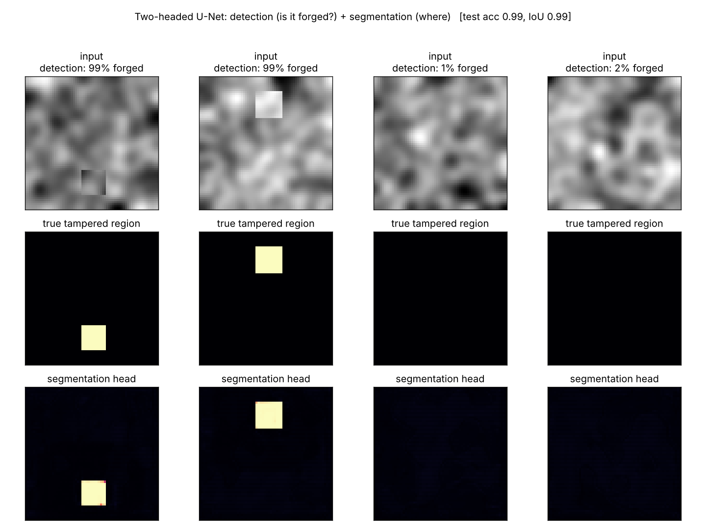

# Two-headed U-Net for copy-move forgery: detection + localisation

[](https://github.com/hager-safwat/copy-move-forgery-unet/actions/workflows/tests.yml)

[](LICENSE)

A minimal, tested demonstration of the task behind a scientific-image forgery
project. Given an image where a patch has been **copied and pasted**
elsewhere (a "copy-move" forgery), a U-Net with a **shared encoder and two
heads** answers both questions at once:

* a **detection** head: *is this image forged?* (one label per image)
* a **segmentation** head: *which pixels are tampered?* (a mask)

Both heads train together on the shared encoder features.



The figure shows held-out test images with the detection head's verdict
(top), the true tampered region (middle) and the segmentation head's
prediction (bottom), including clean images, where the detector correctly
reports "not forged".

## What it does

- **Generates a balanced dataset.** Smoothed-noise images of 64 × 64 pixels.
  Half are left clean; half get a copy-move forgery (a random square patch of
  12 to 21 pixels copied and pasted elsewhere, with a small brightness offset).
  Each image has a label (forged / clean) and a ground-truth mask.
- **Trains a two-headed U-Net.** A shared two-level encoder feeds a
  segmentation decoder with skip connections and a small classification head.
  The total loss is detection BCE plus segmentation BCE and Dice.
- **Evaluates** detection accuracy, segmentation IoU on forged images,
  false-positive pixels on clean images, and one stress test.

## Setup and results

| | |
|---|---|
| Data | 600 training and 120 held-out test images (half forged) |
| Network | two-level U-Net, base width 16, BatchNorm, 119,506 parameters |
| Training | Adam, lr 1e-3, batch 32, 20 epochs |

Held-out test set, seed 0:

| Metric | Value |
|---|---|
| Detection accuracy | 0.992 (119 of 120 images) |
| Segmentation IoU, forged images | 0.986 |
| False-positive pixels per clean image | 0.0 |

**Stress test: exact copies.** A second test set of 120 images where the
pasted patch has *no* brightness offset (a pixel-exact copy): detection
accuracy 1.000, IoU 0.985. So the model is not relying on the brightness
offset; it most likely detects the boundary seam that pasting creates in a
smooth image. That is still a local cue, not duplicate-region matching (see
Scope).

## Where DINOv2 fits

In the full project the **shared encoder** was replaced by features from
**DINOv2**, a large self-supervised vision transformer, which provides much
richer representations than a small convolutional encoder. DINOv2 is too
large for a quick CPU demo, so this repository keeps a lightweight encoder
and focuses on the two-head mechanics. The encoder in `forgery/model.py` is
where a pretrained backbone would be plugged in.

## Run it

```bash
git clone https://github.com/hager-safwat/copy-move-forgery-unet.git
cd copy-move-forgery-unet
pip install -e ".[demo]"
python unet_forgery_demo.py
```

The full run takes a few minutes on a laptop CPU (measured: about 8 minutes
on a 2-core cloud machine). It prints progress and the metrics above and
regenerates `figure.png`. Quick check: `python unet_forgery_demo.py --epochs 1 --no-figure`.

## Tests

```bash
pip install -e ".[dev]"
pytest -v
```

| Test | What it verifies |
|---|---|
| `test_forged_image_mask_is_a_square_patch` | the mask is one square of 12 to 21 px |
| `test_exact_copy_reproduces_source_pixels` | with no offset, the pasted block is pixel-identical to another block of the image |
| `test_both_heads_send_gradient_to_shared_encoder` | each head alone back-propagates into the first encoder layer |
| `test_iou_ignores_clean_images_and_fp_counts_them` | the metrics handle clean images as documented |
| `test_parameter_count` | the architecture matches the size reported above |
| plus data, loss, training and smoke tests | |

Every push and pull request runs `ruff` and the tests on Python 3.10 and 3.12.

## Repository structure

```
forgery/
    data.py        synthetic forged / clean images with masks
    model.py       two-headed U-Net
    training.py    losses, metrics, joint training loop
unet_forgery_demo.py   experiment, stress test and figure
tests/                 pytest suite
```

## Scope

This is a **mechanism demo on synthetic data**: it shows the full forgery
pipeline (data with masks, two-headed U-Net, joint loss, IoU) on an
easy-to-check version of the problem. It is not a benchmark, and the
synthetic detector keys on local paste artifacts rather than doing full
duplicate-region matching, which real copy-move detection in natural or
biomedical images requires. The task and approach come from my master's work
on copy-move forgery detection in biomedical images; this repository
reimplements the core from scratch on toy data, with no project data
involved.

## References

- O. Ronneberger, P. Fischer, T. Brox, *U-Net: Convolutional Networks for
  Biomedical Image Segmentation*, MICCAI 2015.
- M. Oquab et al., *DINOv2: Learning Robust Visual Features without
  Supervision*, 2023.

## License

MIT, see [LICENSE](LICENSE).
